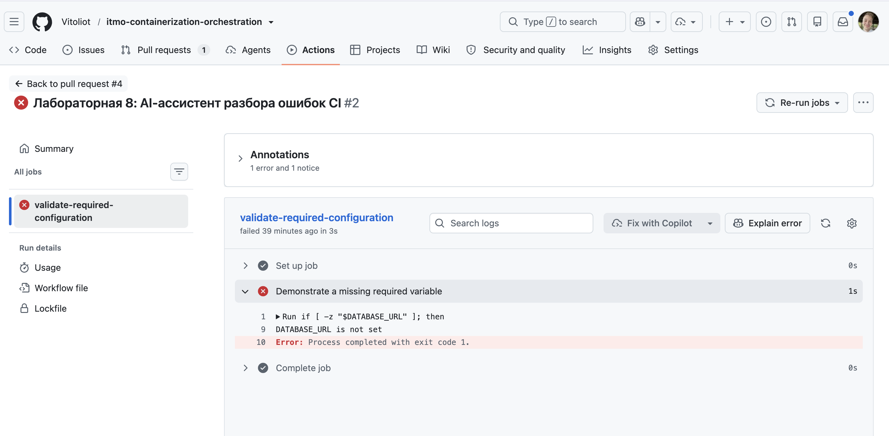
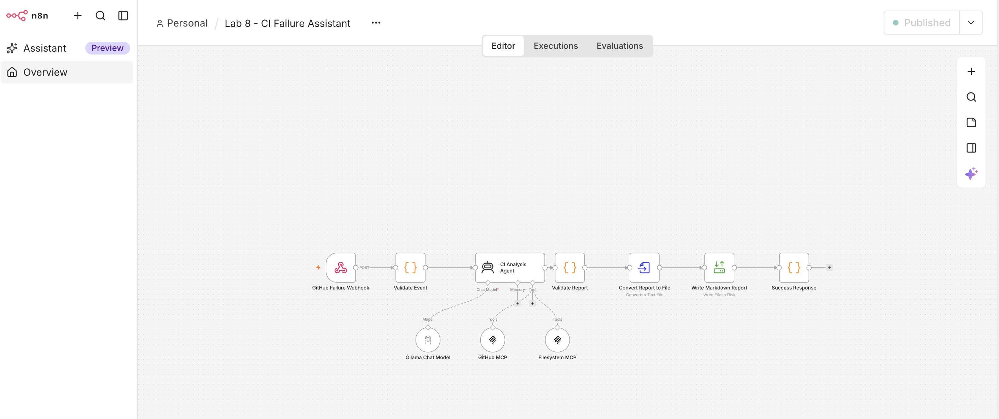
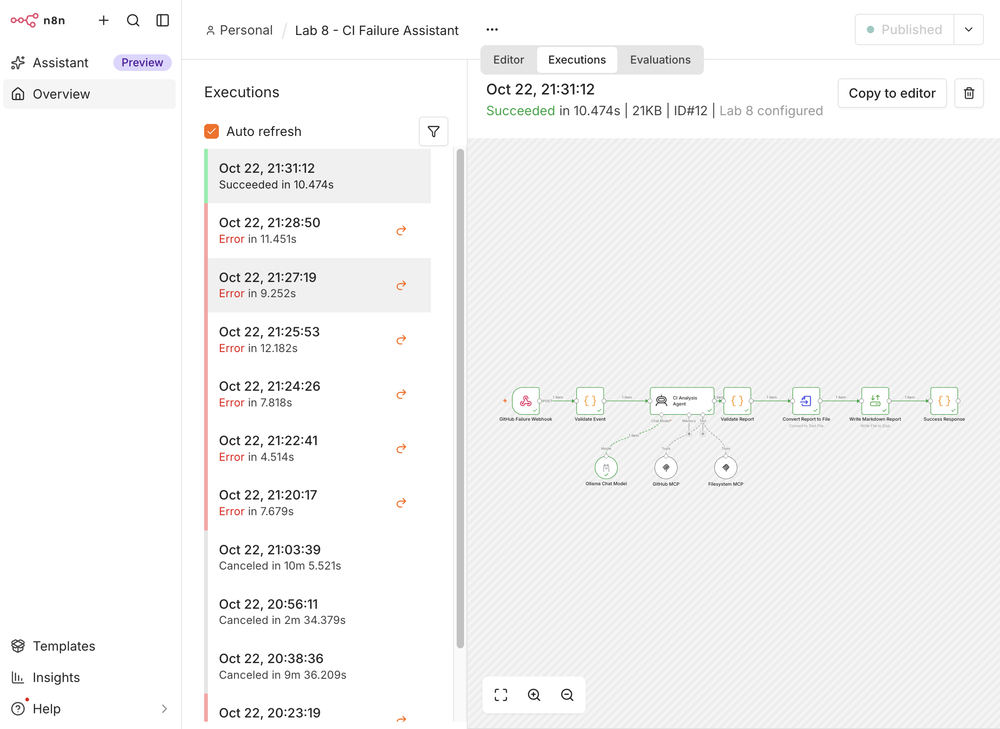
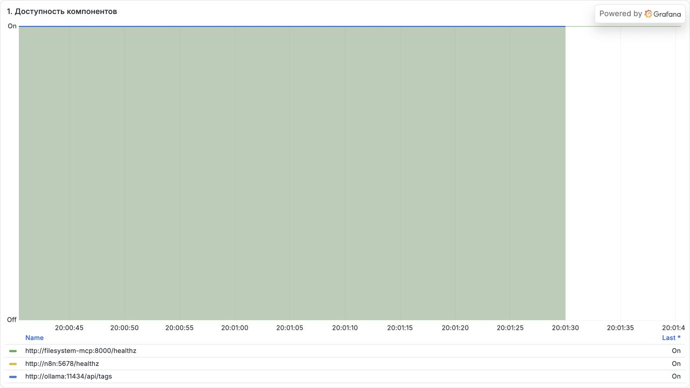
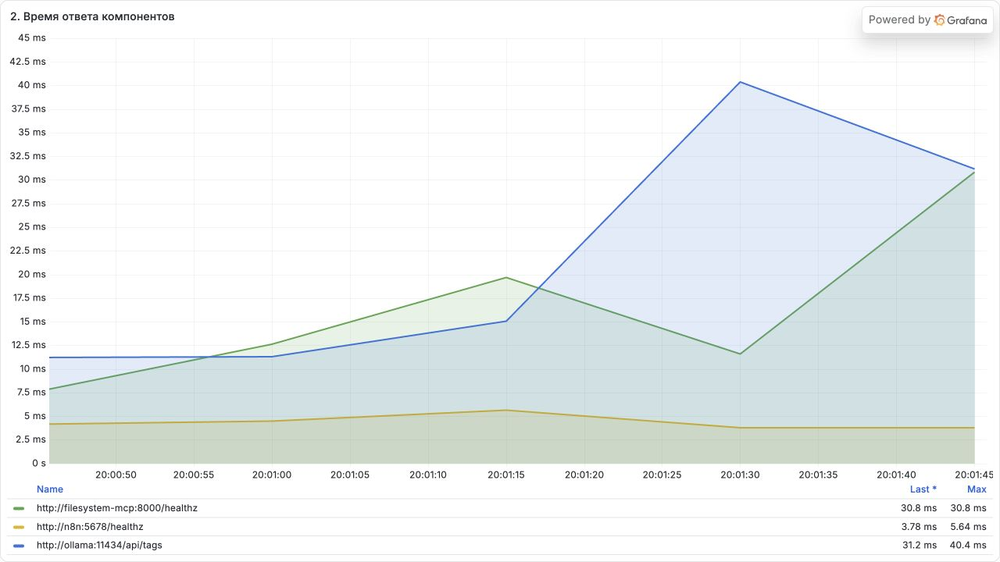
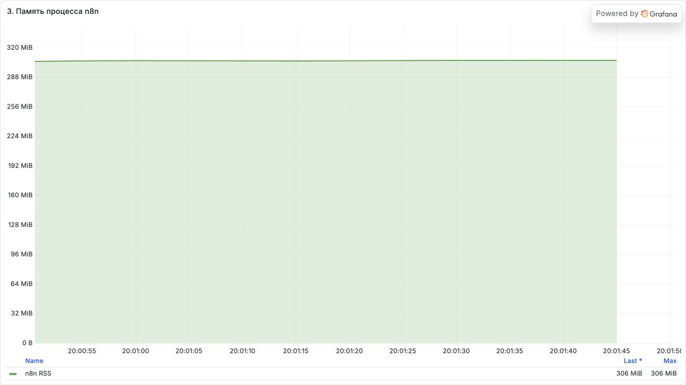

# AI-ассистент разбора неудачных CI-сборок

## Кейс

Продуктовая команда разрабатывает несколько микросервисов и использует GitHub Actions для непрерывной интеграции. После падения сборки разработчики и DevOps-инженеры вручную изучают журнал выполнения, изменения в коммите и внутренние инструкции. Это занимает время, а одинаковые известные ошибки каждый раз диагностируются заново.

Автоматизация запускается входящим webhook от GitHub Actions с данными неудачного запуска. AI-агент через GitHub MCP получает сведения о workflow, коммите и ошибке, а через Filesystem MCP читает локальные runbook'и, карту владельцев сервисов и каталог известных проблем. Затем агент сопоставляет факты с внутренними инструкциями и формирует Markdown-отчёт для разработчиков и DevOps-команды.

Отчёт содержит подтверждённые факты со ссылками на источники, отдельно помеченные гипотезы, вероятную причину сбоя, ответственного владельца и безопасные следующие действия. Если подходящий сценарий отсутствует в runbook, агент не придумывает исправление, а рекомендует ручную диагностику и эскалацию владельцу сервиса.

## Поток данных

`GitHub Actions webhook → n8n → AI-агент → GitHub MCP + Filesystem MCP → Markdown-отчёт`

## Архитектура

| Компонент | Назначение |
|---|---|
| n8n 2.44.6 | Принимает webhook, запускает агента, проверяет результат и записывает отчёт |
| Ollama 0.40.8 + `qwen3:0.6b` | Компактная локальная модель для анализа без внешнего AI API |
| GitHub MCP | Предоставляет сведения о workflow run, failed jobs, логах и коммите |
| Filesystem MCP | Даёт агенту read-only доступ только к каталогу `runbooks/` |
| Supergateway 4.2.0 | Публикует stdio-интерфейс Filesystem MCP как Streamable HTTP для n8n |
| Prometheus 3.14.0 | Собирает встроенные метрики n8n и результаты HTTP-проб |
| Blackbox Exporter 0.28.0 | Проверяет доступность и время ответа n8n, Ollama и MCP |
| Grafana 13.2.4 | Показывает заранее настроенный дашборд из трёх графиков |

GitHub MCP подключается к официальному удалённому endpoint `https://api.githubcopilot.com/mcp/`. Filesystem MCP работает внутри Docker-сети по адресу `http://filesystem-mcp:8000/mcp`. Каталог runbook'ов подключён к MCP-контейнеру в режиме `read-only`, а каталог отчётов доступен для записи только обычному узлу n8n.

## Toolkit агента

| Инструмент | Что делает | Входные данные |
|---|---|---|
| `actions_get` | Получает метаданные workflow run | `method`, `owner`, `repo`, `resource_id` |
| `get_job_logs` | Читает последние строки failed jobs | `owner`, `repo`, `run_id`, `failed_only`, `tail_lines` |
| `get_commit` | Получает метаданные коммита и список изменённых файлов | `owner`, `repo`, `sha`, `detail` |
| `search_files` | Ищет подходящий runbook | `path`, `pattern` |
| `read_text_file` | Читает найденный runbook | `path` |

Порядок работы и ограничения агента описаны в [`skills/ci-failure-analysis.md`](skills/ci-failure-analysis.md).

## Подготовка локального запуска

Требования: Docker Compose, `curl` и `jq`.

1. Запустить сервисы:

   ```bash
   docker compose up -d --build
   ```

   Контейнер `ollama-pull` при первом запуске скачает модель `qwen3:0.6b`. Дождаться окончания можно командой `docker compose logs -f ollama-pull`.

2. Открыть `http://localhost:5678`, создать локального владельца n8n и импортировать [`workflow/ci-failure-assistant.json`](workflow/ci-failure-assistant.json).

3. Создать credential типа **Ollama API** и назначить его узлу `Ollama Chat Model`:
   - рекомендуемый вариант на macOS — нативная Ollama с Base URL `http://host.docker.internal:11434` (использует Metal и работает заметно быстрее);
   - полностью контейнерный вариант — Base URL `http://ollama:11434`.
   В обоих вариантах должна быть загружена модель `qwen3:0.6b`.

4. Создать fine-grained GitHub PAT с доступом только к демонстрационному репозиторию и read-only permissions `Actions` и `Contents`. Добавить его в credential типа **HTTP Bearer Auth** и назначить узлу `GitHub MCP`.

5. Проверить, что узел `Filesystem MCP` видит инструменты `search_files` и `read_text_file`, затем активировать workflow.

6. Передать данные существующего неудачного GitHub Actions run:

   ```bash
   ./scripts/trigger-demo.sh OWNER REPOSITORY RUN_ID HEAD_SHA
   ```

Готовый файл появится в `reports/ci-REPOSITORY-RUN_ID.md`. Тестовый формат события приведён в [`test-data/github-workflow-failure.json`](test-data/github-workflow-failure.json).

## Результат работы

Для демонстрации создан тестовый GitHub Actions run с отсутствующей обязательной переменной `DATABASE_URL`. Job `validate-required-configuration` завершился с кодом `1`, после чего сведения о неудачном запуске были переданы ассистенту.



Ниже показан опубликованный workflow в n8n. Он принимает webhook, проверяет входное событие, запускает AI-агента с GitHub MCP и Filesystem MCP, валидирует ответ и записывает Markdown-файл.



Контрольный запуск для GitHub Actions run `39821630472` успешно прошёл весь workflow за `10.474` секунды: все основные узлы завершились без ошибки, а отчёт был записан в файл.



Полученный результат сохранён в репозитории как [`evidence/ci-failure-report.md`](evidence/ci-failure-report.md). Рабочий каталог `reports/` остаётся в `.gitignore`, чтобы последующие локальные отчёты не попадали в Git автоматически.

## Мониторинг

После `docker compose up -d --build` доступны:

- Grafana: `http://localhost:3000` — вход не требуется, дашборд загружается автоматически;
- Prometheus: `http://localhost:9090`;
- метрики n8n: `http://localhost:5678/metrics`.

Prometheus опрашивает endpoints каждые 5 секунд. Дашборд **Lab 8 — CI Failure Assistant** содержит три графика:

1. `probe_success{job="component-health"}` — доступность n8n, Ollama и Filesystem MCP. Алерт: значение равно `0` две проверки подряд. Потеря любого компонента останавливает весь процесс анализа.
2. `probe_duration_seconds{job="component-health"}` — время ответа компонентов. Алерт: значение выше 1 секунды в течение 5 минут. Рост задержки заранее показывает деградацию до полного отказа.
3. `n8n_process_resident_memory_bytes{job="n8n"}` — физическая память процесса n8n. Алерт: значение выше 1 GiB в течение 10 минут. Длительный рост памяти может закончиться OOM и потерей выполняющегося workflow.

Конфигурация Prometheus и provisioned-дашборд находятся в [`monitoring/`](monitoring/).

### Графики







## Границы безопасности

- GitHub PAT хранится только в зашифрованном хранилище credentials n8n и не коммитится.
- Агент получает только пять инструментов, необходимых для анализа.
- GitHub-инструменты используются только для чтения.
- Runbook'и доступны MCP-серверу только для чтения.
- Запись отчёта выполняет детерминированный узел n8n после проверки обязательных разделов.
