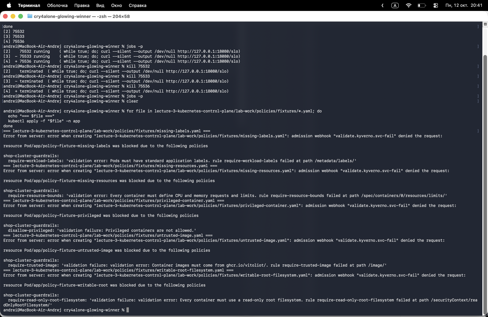
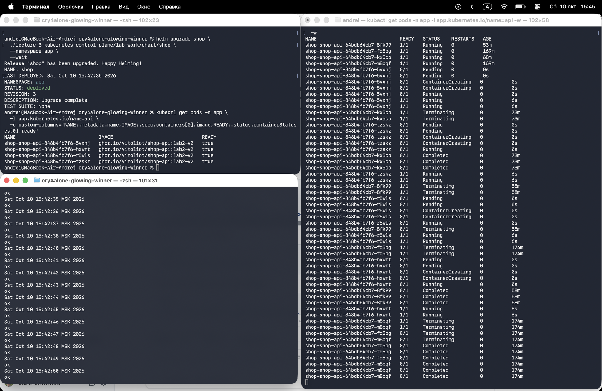
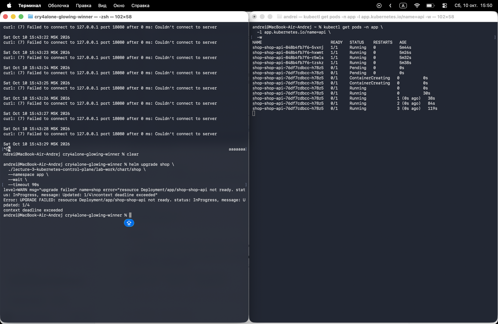
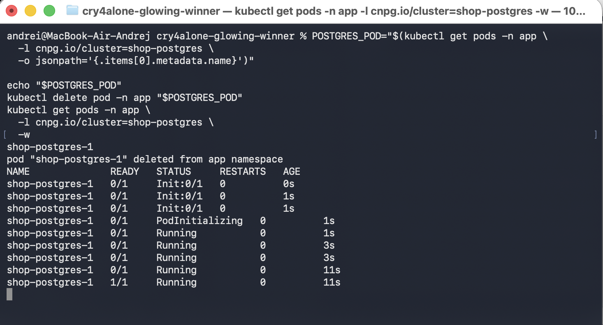
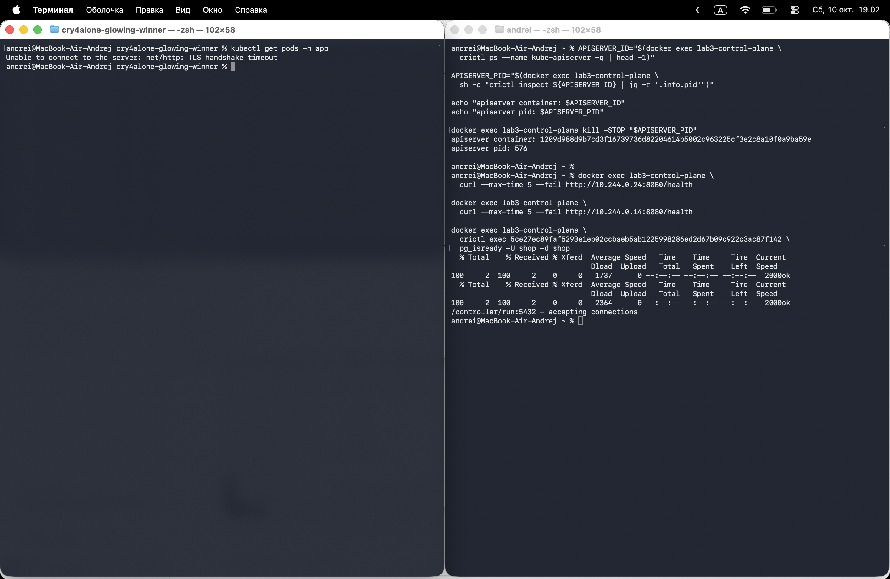
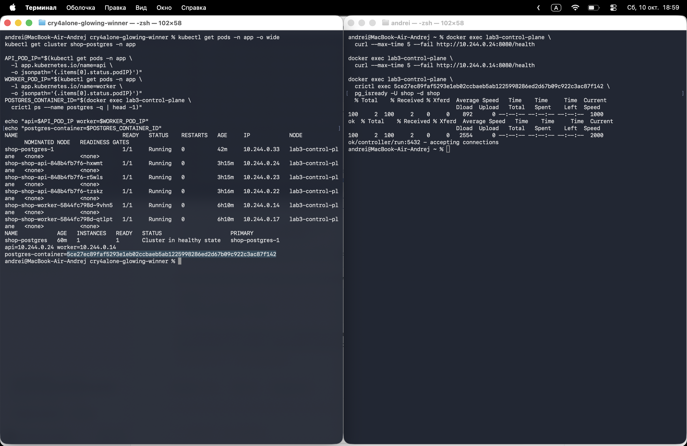
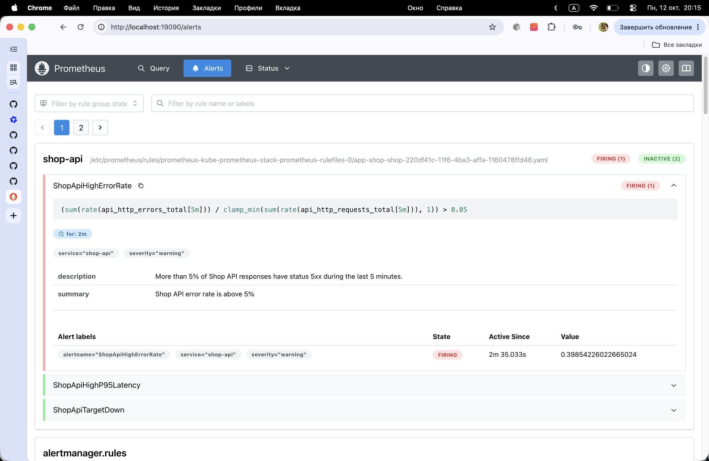
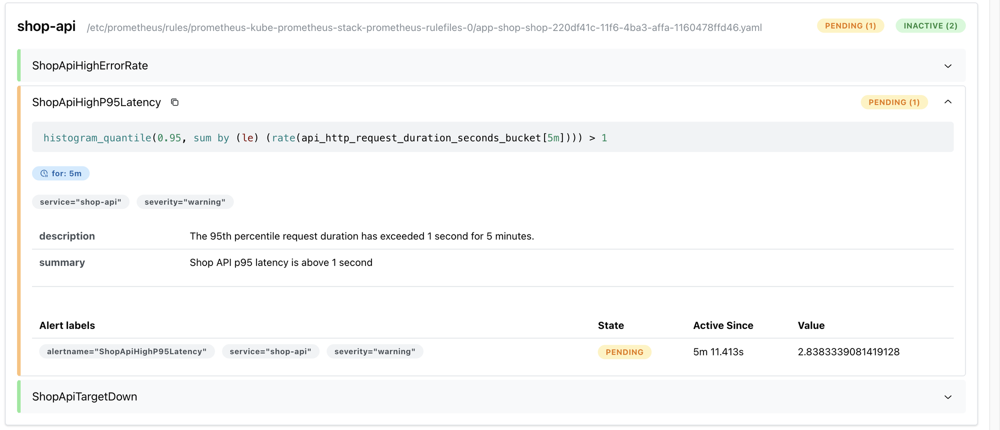

# Лабораторная 3 — Control plane Kubernetes

Рабочий контур для задания 3 по теме **kubernetes-control-plane**. Требования
сопоставлены с эталонным репозиторием курса:

- [описание задания](https://github.com/KeladKaal/containerization-and-orchestration/blob/main-rus/lecture-3-kubernetes-control-plane/lab.md);
- [конспект лекции](https://github.com/KeladKaal/containerization-and-orchestration/blob/main-rus/lecture-3-kubernetes-control-plane/README.md).

## Цель

Собрать локальную платформу для `shop`, в которой:

- политики не принимают небезопасные манифесты;
- Helm-чарт управляет `api` и `worker`;
- PostgreSQL управляется оператором через CRD;
- reconciliation, rolling update, rollback и восстановление после удаления
  проверяются на живом кластере;
- метрики и три алерта подключаются к стеку мониторинга из предыдущих работ.

## Структура

```text
lecture-3-kubernetes-control-plane/
├── README.md
├── lab.md
├── lab-work/
│   ├── policies/        # ClusterPolicy и негативные тестовые манифесты
│   ├── chart/shop/      # Helm-чарт api, worker и объекта PostgreSQL
│   ├── services/        # api и worker для сценариев лабораторной
│   └── monitoring/      # ServiceMonitor и PrometheusRule
└── screenshots/         # подтверждения проверок
```

Каталог `api/` в корне репозитория и материалы лабораторной 1 не меняются:
сервисы для этой лабораторной будут изолированы в `lab-work/services/`.

## Организация работы

Все пояснения к структуре и решениям хранятся в этом README. Вложенные
каталоги содержат только рабочие файлы: Kubernetes-манифесты, Helm-шаблоны,
исходники сервисов, конфигурации мониторинга и подтверждения проверок.

### Сервисы

`lab-work/services/api/` содержит расширенный `api` из лабораторной 2:
`/health`, `/metrics`, `/fail`, `/slow` и `/load`, а также Prometheus-метрики,
JSON-логи и OpenTelemetry-трейсы. Для лабораторной 3 добавлена переменная
`HEALTH_FAIL=true`: при ней `/health` отвечает `503`, чтобы показать
зависший rollout. Отдельный `worker` будет добавлен для сценария `shop`.

### Helm-чарт

`lab-work/chart/shop/Chart.yaml` описывает Helm-пакет, а `values.yaml` содержит
изменяемые параметры: реплики, образы, переменные окружения, ресурсы,
security context и probes. Шаблоны из `templates/` будут превращать эти
значения в Deployment и Service для `api` и `worker`.

Для `api` задано три реплики по умолчанию, для `worker` — две. Образы имеют
префикс `ghcr.io/vitoliot/`, потому что это разрешённый префикс текущей
Kyverno-политики; локальные образы будут загружаться в kind через
`kind load docker-image`.

В шаблонах обязательно должны сохраняться требования первой части:
requests/limits, стандартные labels, запрет privileged-контейнеров и
`readOnlyRootFilesystem: true`.

Сейчас добавлен минимальный `worker` с `/health`, чтобы отдельно проверить
второй Deployment/Service и две реплики. Интеграция worker с заказами и
PostgreSQL относится к следующему этапу задания; текущий worker нужен для
освоения Helm и reconciliation, а не заменяет будущую бизнес-логику.
Оба Dockerfile запускают приложение от числового непривилегированного UID
`10001`, чтобы это было совместимо с `runAsNonRoot: true`.

### Мониторинг и подтверждения

`lab-work/monitoring/` предназначен для ресурсов `ServiceMonitor` и
`PrometheusRule`, использующих стек лабораторной 2. Новый стек мониторинга
для лабораторной 3 не создаётся. В `screenshots/` будут храниться результаты
проверок политик, установки чарта, reconciliation, rollout/rollback,
оператора PostgreSQL и поведения при падении control plane.

## Политики кластера

Для первой части выбран **Kyverno**. Он проще для этой лабораторной, потому
что политика сама является Kubernetes-ресурсом (`ClusterPolicy`) и описывается
в YAML. Не нужно отдельно изучать Rego, писать ConstraintTemplate и собирать
два связанных объекта Gatekeeper.

Политика — это автоматическая проверка или модификация ресурса Kubernetes.
Например, пользователь отправляет `Deployment` через `kubectl apply`, а
Kyverno перехватывает запрос admission-контроллером и проверяет его до записи
в API-сервер. Если ресурс нарушает правило с режимом `Enforce`, API-сервер
отклоняет запрос.

Манифест — это YAML-документ, описывающий желаемое состояние ресурса:
`kind`, `metadata` и `spec`. Поэтому `ClusterPolicy` — тоже манифест, только
его `spec` содержит правила проверки. Файлы в
`lab-work/policies/fixtures/` — намеренно неправильные манифесты для
доказательства, что ограждения действительно работают.

В первой итерации добавлены пять правил:

1. обязательные CPU и memory `requests`/`limits` — планировщик видит
   потребление, а один Pod не может неограниченно занять узел;
2. образы только из `ghcr.io/vitoliot/` — уменьшается риск запуска
   непроверенного или подменённого образа;
3. обязательные `app.kubernetes.io/name` и `app.kubernetes.io/part-of` —
   ресурсы единообразно ищутся, группируются и наблюдаются;
4. `privileged: true` запрещён — контейнер не получает лишние права на узле;
5. `readOnlyRootFilesystem: true` обязателен — компрометация процесса не
   должна превращать root-файловую систему контейнера в постоянное хранилище.

Рабочая политика находится в
[`lab-work/policies/cluster-policies.yaml`](lab-work/policies/cluster-policies.yaml),
а пять негативных примеров — в
[`lab-work/policies/fixtures/`](lab-work/policies/fixtures/).

## Отчёт по Части 1 — ограждения на кластере

### Выбор Kyverno

Для лабораторной выбран **Kyverno**, потому что его политики описываются
обычными Kubernetes-манифестами YAML. Для локального учебного кластера это
проще, чем OPA/Gatekeeper: не требуется отдельно изучать Rego,
`ConstraintTemplate` и связанные с ним `Constraint`.

Kyverno работает как admission webhook. Когда пользователь отправляет
ресурс через `kubectl apply`, API-сервер перед сохранением передаёт запрос
Kyverno. Политика с `validationFailureAction: Enforce` отклоняет ресурс, если
он не соответствует правилам.

### Правила

В `cluster-policies.yaml` добавлены пять кластерных правил:

1. **`require-resource-bounds`** требует CPU и memory `requests`/`limits`.
   Scheduler получает информацию о гарантированном потреблении, а контейнер
   не может бесконтрольно занять ресурсы узла.
2. **`require-trusted-image`** разрешает образы только с префиксом
   `ghcr.io/vitoliot/`. Это ограничивает запуск непроверенных или случайно
   подменённых образов.
3. **`require-workload-labels`** требует метки
   `app.kubernetes.io/name` и `app.kubernetes.io/part-of`. Они нужны для
   выбора Pod Service-ами, поиска ресурсов и группировки мониторинга.
4. **`disallow-privileged`** запрещает `privileged: true`, чтобы контейнеры
   не получали лишние права и доступ к ресурсам узла.
5. **`require-read-only-root-filesystem`** требует
   `readOnlyRootFilesystem: true`. При компрометации процесса это ограничивает
   изменение файлов приложения внутри контейнера.

Системные namespace `kyverno`, `cnpg-system`, `kube-system` и
`local-path-storage` исключены из этих прикладных ограждений. Это необходимо
для самого механизма работы кластера: Kyverno, CloudNativePG и kind
используют служебные образы, helper Pod-ы и Deployment-ы, которые не обязаны
соответствовать доверенному префиксу образов приложения. Также исключены
ресурсы CloudNativePG с label `cnpg.io/cluster` и bootstrap-ресурсы
`shop-postgres-*` в `app`. Исключения не ослабляют проверку `api` и `worker`.

### Проверка

Kyverno был установлен в kind-кластер `lab3` через Helm. Политика
`shop-cluster-guardrails` получила `READY=True`, `ADMISSION=True` и
`BACKGROUND=True`.

Пять fixtures были проверены через реальный admission webhook:

| Fixture | Нарушенное правило | Результат |
|---|---|---|
| `missing-resources.yaml` | отсутствуют requests/limits | отклонён |
| `untrusted-image.yaml` | образ вне доверенного реестра | отклонён |
| `missing-labels.yaml` | отсутствуют обязательные labels | отклонён |
| `privileged-container.yaml` | включён privileged-контейнер | отклонён |
| `writable-root-filesystem.yaml` | root filesystem доступна для записи | отклонён |

Корректный Pod с доверенным образом, labels, ресурсами и read-only root
filesystem прошёл `kubectl create --dry-run=server`.

На скриншоте ниже показан запуск всех пяти негативных fixtures через
`kubectl apply`. Каждый манифест был отклонён admission webhook Kyverno, а
текст ошибки указывает именно на нарушенное правило: labels, resource bounds,
`privileged`, trusted image или read-only root filesystem.



## Текущий статус

Часть 1 проверена в отдельном kind-кластере `lab3`: Kyverno установлен через
Helm, политика имеет `READY=True`, все пять негативных манифестов отклоняются
admission webhook, а корректный Pod проходит server-side dry-run.

Часть 2 начата: расширенный `api` перенесён из ветки `lab2` в
`lab-work/services/api/`, добавлен `HEALTH_FAIL`, созданы `Chart.yaml` и
`values.yaml`. Для `api` добавлены Helm-шаблоны Deployment и Service:
рендеринг показывает три реплики, rolling update с `maxUnavailable: 0`,
ресурсы, probes и security context, а server-side dry-run проходит Kyverno.
Для `worker` добавлены минимальный HTTP-сервис, Deployment и Service с двумя
репликами. Образы собраны локально, загружены в kind-узел, а release `shop`
установлен в namespace `app`. Сейчас `api` работает в конфигурации `3/3`,
`worker` — `2/2`, оба Service имеют endpoints, а `/health` и `/metrics`
проверены через `shop-shop-api`.

Во время первой установки обнаружились и были исправлены две практические
проблемы: образ `api` не объявлял непривилегированного пользователя, а
FastAPI не принимал аннотацию `str | JSONResponse` для `/health`. Оба
Dockerfile теперь используют UID `10001`, а endpoint возвращает тип
`Response`, совместимый с установленной версией FastAPI.

## Отчёт по Части 2 — Helm и reconciliation

### Подготовка и установка

Решение лабораторной 2 использовано как основа: расширенный `api` с
метриками, JSON-логами, OpenTelemetry и endpoint `/health` перенесён в
`lab-work/services/api/`. Для проверки неудачного обновления добавлена
переменная `HEALTH_FAIL`: при значении `true` `/health` отвечает `503`.

Создан Helm-чарт `shop`:

- `Chart.yaml` описывает пакет и его версии;
- `values.yaml` задаёт реплики, образы, окружение, ресурсы, probes и
  security context;
- `api` разворачивается с тремя репликами;
- минимальный `worker` разворачивается с двумя репликами;
- оба Deployment имеют labels, requests/limits,
  `runAsNonRoot`, `readOnlyRootFilesystem` и readiness/liveness probes.

Локальные образы были собраны с именами, разрешёнными Kyverno, загружены в
kind-узел через `kind load docker-image`, после чего release установлен в
namespace `app`. Итоговое состояние после установки:

```text
api:     3/3 Ready
worker:  2/2 Ready
```

### Reconciliation

После ручного удаления одного Pod `api` Deployment обнаружил расхождение
между желаемым состоянием `replicas: 3` и фактическими двумя Pod. ReplicaSet
создал новый Pod, который стал `Ready`. Kubernetes не «воскресил» удалённый
объект, а создал новый Pod на основании шаблона Deployment.

Затем значение `api.replicaCount` временно изменялось с 3 на 4. Команда
`helm upgrade` создала четвёртую реплику. После возврата значения к 3 лишний
Pod был удалён. Это показало reconciliation желаемого состояния,
описанного в `values.yaml`.

### Rolling update

Для запуска настоящего обновления образ `api` был пересобран под новым тегом
`lab2-v2`, загружен в kind и указан в `values.yaml`. Изменение image tag
изменило Pod template Deployment и создало новый ReplicaSet.

В Deployment заданы:

```yaml
rollingUpdate:
  maxUnavailable: 0
  maxSurge: 1
```

Поэтому Kubernetes создавал новый Pod, ждал его readiness, затем удалял
один старый Pod и переходил к следующему. Старые и новые ReplicaSet
временно существовали одновременно, а после успешного rollout остались
только Pod с образом `shop-api:lab2-v2`.

Скриншот показывает этот процесс одновременно в трёх
терминалах: `helm upgrade` завершился успешно с новой ревизией, Pod
переходили через `Pending`/`ContainerCreating`/`Running`, а непрерывные
запросы к `/slow` продолжали получать ответы `ok`. Это подтверждает, что
rolling update выполняется постепенно и сервис остаётся доступным во время
замены Pod.



### Заведомо сломанный rollout

Для следующей ревизии в values было установлено:

```yaml
HEALTH_FAIL: "true"
```

Новые Pod начали возвращать `503` на `/health`, поэтому не проходили
readiness probe. При `maxUnavailable: 0` старые исправные Pod нельзя было
удалить: это нарушило бы гарантированное число доступных реплик.

Helm с `--wait` завершился по timeout с сообщением:

```text
resource Deployment/app/shop-shop-api not ready
Updated: 1/4
context deadline exceeded
```

В результате старые Pod оставались `1/1 Running`, а новый Pod был
`0/1` и перезапускался из-за liveness-проверки того же endpoint. Service
продолжал обслуживать запросы через старые готовые Pod; локальный
`port-forward` мог оборваться только потому, что он был привязан к
конкретному Pod, который удалялся во время обновления.



### Rollback

Рабочей перед сломанным обновлением была ревизия 3. После неудачной ревизии 4
выполнено:

```bash
helm rollback shop 3 \
  --namespace app \
  --wait \
  --timeout 5m
```

Rollback завершился успешно, Deployment снова прошёл rollout, а рабочие Pod
вернулись в состояние `Ready`. Helm создал новую ревизию с восстановленной
конфигурацией; история предыдущих ревизий сохранилась.


На скриншоте видно, что `helm rollback shop 3 --wait` завершился успешно с
сообщением `Rollback was a success! Happy Helming!`, а затем `kubectl rollout
status` подтвердил, что новый Deployment снова получает готовые Pod.

Итог Части 2: Helm описывает желаемое состояние, Deployment и ReplicaSet
постоянно сверяют его с фактическим состоянием, rolling update обновляет Pod
по одному, readiness защищает рабочую версию от неудачного релиза, а
`helm rollback` возвращает последнюю рабочую конфигурацию.

## Часть 3 — PostgreSQL через оператор

### Выбор CloudNativePG

Для PostgreSQL выбран **CloudNativePG**. Оператор устанавливается один раз
на кластер, а приложение описывает базу декларативным объектом `Cluster`.
В чарт `shop` добавлен шаблон
[`templates/postgres-cluster.yaml`](lab-work/chart/shop/templates/postgres-cluster.yaml).
По умолчанию он создаёт один экземпляр PostgreSQL с базой `shop`, владельцем
`shop`, ресурсами и PVC размером `1Gi`. Один экземпляр достаточен для
локальной демонстрации reconciliation и не требует лишних ресурсов kind.

В отличие от обычного Deployment, Helm не описывает Pod PostgreSQL напрямую.
Helm создаёт только CR `Cluster`, а CloudNativePG самостоятельно создаёт
StatefulSet-подобную инфраструктуру, PVC, Service и Pod базы. Если Pod базы
удалить, оператор увидит расхождение между объектом `Cluster` и фактическим
состоянием и создаст замену.

### Установка оператора

Оператор устанавливается отдельно от чарта и только один раз на кластер:

```bash
helm repo add cnpg https://cloudnative-pg.github.io/charts
helm repo update
helm upgrade --install cnpg cnpg/cloudnative-pg \
  --namespace cnpg-system \
  --create-namespace \
  --wait \
  --timeout 5m
```

Проверить готовность оператора:

```bash
kubectl get pods -n cnpg-system
kubectl get crd clusters.postgresql.cnpg.io
```

После этого установить или обновить `shop`:

```bash
helm upgrade --install shop \
  ./lecture-3-kubernetes-control-plane/lab-work/chart/shop \
  --namespace app \
  --create-namespace \
  --wait \
  --timeout 5m
```

Проверить объект оператора и созданный Pod:

```bash
kubectl get cluster -n app
kubectl get cluster shop-postgres -n app -o yaml
kubectl get pods,pvc,svc -n app -l cnpg.io/cluster=shop-postgres
```

В YAML объекта нужно показать две части:

- `spec` — желаемое состояние: количество экземпляров, образ PostgreSQL,
  bootstrap-база, размер хранилища и ресурсы;
- `status` — фактическое состояние: готовность кластера, primary, число
  готовых экземпляров и условия оператора.

### Проверка reconciliation оператора

Удалить Pod PostgreSQL и наблюдать восстановление:

```bash
POSTGRES_POD="$(kubectl get pods -n app \
  -l cnpg.io/cluster=shop-postgres \
  -o jsonpath='{.items[0].metadata.name}')"

kubectl delete pod -n app "$POSTGRES_POD"
kubectl get pods -n app -l cnpg.io/cluster=shop-postgres -w
```

После удаления старого Pod оператор создаст новый с тем же кластером и
хранилищем. Это отдельный уровень reconciliation:

| Компонент | Что он поддерживает |
|---|---|
| `kube-controller-manager` | базовые встроенные ресурсы Kubernetes: Deployment, ReplicaSet, Node, Job и другие |
| CloudNativePG operator | PostgreSQL-специфические ресурсы: primary/replica, bootstrap, PVC, failover, Service и состояние CR `Cluster` |

`controller-manager` — часть самого Kubernetes control plane и содержит
набор встроенных контроллеров. Оператор CloudNativePG — расширение,
работающее через CRD и собственный controller: он добавляет Kubernetes API
новый тип `Cluster` и знает, как управлять именно PostgreSQL.

### Результаты Части 3

PostgreSQL-кластер успешно интегрирован через оператор:

```text
kubectl get cluster shop-postgres -n app
NAME            AGE     INSTANCES   READY   STATUS
shop-postgres   2m47s   1           1       Cluster in healthy state
```

Оператор создал полный набор ресурсов на основе CR:

```yaml
spec:
  instances: 1
  imageName: ghcr.io/cloudnative-pg/postgresql:16.4
  bootstrap:
    initdb:
      database: shop
      owner: shop
  storage:
    size: 1Gi
    storageClass: standard
  resources:
    requests:
      cpu: 100m
      memory: 256Mi
    limits:
      cpu: 500m
      memory: 512Mi

status:
  phase: "Cluster in healthy state"
  readyInstances: 1
  instances: 1
  instanceNames:
    - shop-postgres-1
  conditions:
    - type: Ready
      status: "True"
    - type: ContinuousArchiving
      status: "True"
      message: "Continuous archiving is working"
```

#### Тест reconciliation

Pod PostgreSQL удалён ручно для проверки reconciliation:



Оператор обнаружил расхождение между объектом CR (1 экземпляр требуется) и
фактическим состоянием (0 Pod), создал новый Pod и инициализировал его с
тем же кластером и PVC. Pod прошёл фазы `Init:0/1 → PodInitializing → Running`
и стал полностью готовым (`1/1 Running`) за ~11 секунд.

Этот результат показывает, что reconciliation работает корректно: Helm
описывает декларативное состояние, Deployment управляет API приложения, а
оператор непрерывно поддерживает PostgreSQL в синхронизации с CR.

## Часть 4 — отказ control plane

Цель проверки — разделить доступность уже запущенных workloads и доступность
Kubernetes API. При остановленном `kube-apiserver` новые операции управления
(`kubectl get`, `kubectl delete`, `helm upgrade`) недоступны, но уже созданные
Pod продолжают работать на узле. Контроллеры не могут получить новые события
через API, поэтому reconciliation возобновится только после восстановления
apiserver.

Проверка выполняется на локальном kind-кластере `lab3`. Важно не останавливать
контейнер `lab3-control-plane` целиком: это остановит и workloads, если
приложение запущено на том же single-node кластере. Вместо этого временно
приостанавливается только процесс `kube-apiserver`.

### Подготовка наблюдения

Сначала убедитесь, что все workloads готовы, и сохраните их IP-адреса до
отказа API:

```bash
kubectl get pods -n app -o wide
kubectl get cluster shop-postgres -n app

API_POD_IP="$(kubectl get pods -n app \
  -l app.kubernetes.io/name=api \
  -o jsonpath='{.items[0].status.podIP}')"
WORKER_POD_IP="$(kubectl get pods -n app \
  -l app.kubernetes.io/name=worker \
  -o jsonpath='{.items[0].status.podIP}')"
POSTGRES_CONTAINER_ID="$(docker exec lab3-control-plane \
  crictl ps --name postgres -q | head -1)"

echo "api=$API_POD_IP worker=$WORKER_POD_IP"
echo "postgres-container=$POSTGRES_CONTAINER_ID"
```

Откройте отдельный терминал для проверки трафика через сеть kind-ноды:

```bash
docker exec -it lab3-control-plane sh
curl --fail "http://${API_POD_IP}:8080/health"
curl --fail "http://${WORKER_POD_IP}:8080/health"
crictl exec "$POSTGRES_CONTAINER_ID" pg_isready -U shop -d shop
```

Ожидаемый результат до отказа:

```text
ok
ok
/var/run/postgresql:5432 - accepting connections
```

### Остановка только kube-apiserver

В основном терминале сохраните PID процесса и приостановите его сигналом
`SIGSTOP`:

```bash
APISERVER_ID="$(docker exec lab3-control-plane \
  crictl ps --name kube-apiserver -q | head -1)"
APISERVER_PID="$(docker exec lab3-control-plane \
  sh -c "crictl inspect ${APISERVER_ID} | jq -r '.info.pid'")"
test -n "$APISERVER_PID"
docker exec lab3-control-plane kill -STOP "$APISERVER_PID"
```

После этого зафиксируйте недоступность control plane:

```bash
kubectl get pods -n app
helm list -n app
```

Обе команды должны завершиться ошибкой подключения к Kubernetes API. В
параллельном терминале повторите `curl` и `pg_isready`: уже запущенные `api`,
`worker` и PostgreSQL должны продолжать отвечать, потому что их процессы и
сетевые соединения не зависят от обработки новых запросов API.

### Восстановление и проверка реакции кластера

Мы возвращаем процесс apiserver сигналом `SIGCONT` и сразу проверяем, что
кластер снова откликается на управление:

```bash
docker exec lab3-control-plane kill -CONT "$APISERVER_PID"
kubectl wait --for=condition=Ready node/lab3-control-plane --timeout=60s
kubectl get pods -n app
kubectl get cluster shop-postgres -n app
```

После восстановления API снова доступны `kubectl` и `helm`, а control plane
снова начинает обслуживать события и reconciliation. Важный результат этого
этапа: приложение не было разрушено во время паузы apiserver, и после
возобновления управления кластер быстро вернулся в нормальное состояние.

### Результаты проверки

Во время эксперимента `kube-apiserver` был приостановлен сигналом `SIGSTOP`.
Операция управления завершилась ошибкой:

```text
Unable to connect to the server: net/http: TLS handshake timeout
```

При этом уже запущенные workloads продолжили работать:

```text
api:      ok
worker:   ok
postgres: /controller/run:5432 - accepting connections
```



После отправки `SIGCONT` API-сервер восстановился. Команды `kubectl` снова
стали доступны, PostgreSQL остался в состоянии `Cluster in healthy state`, а
все приложения продолжили работать без ручного вмешательства.



## Часть 5 — мониторинг и алерты

Для мониторинга используются метрики приложения из лабораторной 2 и
Prometheus Operator-ресурсы. Отдельная копия Prometheus/Grafana для этой
лабораторной не создаётся: чарт публикует `ServiceMonitor` и
`PrometheusRule`, а существующий monitoring stack сам обнаруживает их через
свои label selectors.

API уже экспортирует метрики на `/metrics`:

- `api_http_requests_total` — число HTTP-запросов с labels `method`, `route` и
  `status_code`;
- `api_http_errors_total` — число ответов со статусом `5xx`;
- `api_http_request_duration_seconds` — histogram длительности запросов.

### ServiceMonitor

Шаблон
[`templates/servicemonitor.yaml`](lab-work/chart/shop/templates/servicemonitor.yaml)
находит Service API по стандартным labels и настраивает scrape endpoint:

```yaml
endpoints:
  - port: http
    path: /metrics
    interval: 15s
```

`ServiceMonitor` включён в `values.yaml` через
`monitoring.serviceMonitor.enabled`. Если установленный Prometheus Operator
использует обязательный label, его можно передать без изменения шаблона:

```yaml
monitoring:
  serviceMonitor:
    labels:
      release: kube-prometheus-stack
```

### PrometheusRule и выбор алертов

В
[`templates/prometheusrule.yaml`](lab-work/chart/shop/templates/prometheusrule.yaml)
определены три алерта:

1. **`ShopApiHighErrorRate`** срабатывает при доле ответов `5xx` выше 5%
   в течение двух минут. Он показывает ошибки приложения, а не только
   недоступность Pod. Это сигнал о том, что сервис доступен, но бизнес-запросы
   завершаются ошибками.
2. **`ShopApiHighP95Latency`** срабатывает, когда 95-й перцентиль задержки
   превышает одну секунду в течение пяти минут. Он обнаруживает медленное
   обслуживание запросов даже при статусе `200`. P95 выбран вместо среднего
   значения, потому что среднее может скрыть проблемы у части пользователей:
   перцентиль показывает хвост распределения задержек.
3. **`ShopApiTargetDown`** срабатывает, если Prometheus не может скрейпить
   Service API в течение двух минут. Он показывает проблемы с Pod, Service,
   сетью или самим endpoint `/metrics`. Это отдельный инфраструктурный сигнал:
   он отличает недоступность самого target от ситуации, когда target доступен,
   но отвечает ошибками или медленно.

Именно эта тройка покрывает три независимых класса отказов:

| Алерт | Что проверяет | Почему нужен |
|---|---|---|
| `ShopApiHighErrorRate` | корректность ответов приложения | обнаруживает массовые HTTP 5xx при доступном API |
| `ShopApiHighP95Latency` | качество обслуживания запросов | обнаруживает деградацию производительности, которую readiness не показывает |
| `ShopApiTargetDown` | доступность метрик и сети | обнаруживает недоступный Pod, Service, endpoint или scrape-маршрут |

Порог и `for` защищают от случайного единичного события: один ошибочный
запрос или короткий сетевой сбой не создают ложную тревогу. При этом
`ShopApiTargetDown` использует и `up == 0`, и `absent(up)`, потому что при
полном исчезновении endpoints Prometheus может удалить target из набора
временных рядов.

Проверка после установки чарта:

```bash
helm upgrade --install shop \
  ./lecture-3-kubernetes-control-plane/lab-work/chart/shop \
  --namespace app \
  --wait \
  --timeout 5m

kubectl get servicemonitor,prometheusrule -n app
kubectl describe servicemonitor shop-shop-api -n app
kubectl describe prometheusrule shop-shop -n app
```

Для демонстрации firing-состояния можно вызвать намеренные ошибки API:

```bash
API_URL="http://127.0.0.1:18080"
for i in $(seq 1 50); do
  curl --silent --output /dev/null "${API_URL}/fail"
done
```

Перед этим запусти port-forward в отдельном терминале:

```bash
kubectl port-forward -n app svc/shop-shop-api 18080:8080
```

После интервала `for: 2m` алерт `ShopApiHighErrorRate` должен появиться в
Prometheus как `FIRING`. Состояние проверяется в UI Prometheus или через его
API:

```bash
kubectl port-forward -n monitoring svc/kube-prometheus-stack-prometheus 19090:9090
curl --silent http://127.0.0.1:19090/api/v1/alerts
```

Фактическое имя Service Prometheus зависит от установленного в лаборатории
2 стека; его можно найти командой `kubectl get svc -A | grep -i prometheus`.

В текущем репозитории конфигурация лаборатории 1 запускает обычный Docker
Prometheus для метрик cAdvisor. Он не обрабатывает CRD `ServiceMonitor` и
`PrometheusRule`. Для этой части нужен Prometheus Operator-совместимый
экземпляр в Kubernetes (например, уже установленный в кластере стек
`kube-prometheus-stack`); это не дополнительная копия мониторинга в чарте, а
контроллер, который обнаруживает эти два ресурса.

### Установка совместимого стека и результат

В kind-кластер установлен существующий Prometheus Operator-совместимый стек
`kube-prometheus-stack`. Grafana и Alertmanager для этой лабораторной не
поднимаются, потому что требуется проверить именно сбор метрик и состояние
правила:

```bash
helm repo add prometheus-community \
  https://prometheus-community.github.io/helm-charts
helm repo update

helm upgrade --install kube-prometheus-stack \
  prometheus-community/kube-prometheus-stack \
  --namespace monitoring \
  --create-namespace \
  --set grafana.enabled=false \
  --set alertmanager.enabled=false \
  --set prometheus.prometheusSpec.retention=1d \
  --wait \
  --timeout 10m
```

Поскольку служебные Pod стека не являются приложением `shop`, namespace
`monitoring` добавлен в исключения только для прикладных Kyverno-правил.
Это позволяет установить Operator, не ослабляя проверки ресурсов в `app`.

После установки Prometheus обнаружил API как target с состоянием `up`, а
Operator загрузил все три правила:

```text
ServiceMonitor: shop-shop-api
PrometheusRule:  shop-shop
Rules:           ShopApiHighErrorRate, ShopApiHighP95Latency, ShopApiTargetDown
Target:          shop-shop-api — up
```

Для проверки алерта было сгенерировано 5xx-движение запросами к `/fail`.
После истечения `for: 2m` результат Prometheus API:

```text
ShopApiHighErrorRate  firing
ShopApiHighP95Latency inactive
ShopApiTargetDown     inactive
```

Таким образом, метрики приложения действительно прошли путь
`/metrics → ServiceMonitor → Prometheus → PrometheusRule`, а не просто были
описаны в Helm-шаблоне.

### Визуальная проверка p95-алерта

Для проверки задержки непрерывно вызывался endpoint `/slow`, который
искусственно выполняет запрос несколько секунд. Сначала Prometheus зафиксировал
условие, но держал его в состоянии `PENDING`, пока не истёк интервал
`for: 5m`:



На этом этапе значение p95 было около `2.83` секунды, то есть условие
`> 1` выполнялось, но алерт ещё не считался подтверждённым.

После непрерывной нагрузки алерт перешёл в `FIRING`:



На скриншоте видно:

```text
ShopApiHighP95Latency  FIRING
Value:                  2.84
for:                    5m
```

Это подтверждает, что Prometheus вычисляет histogram quantile по метрикам
приложения и переводит правило в `FIRING` только после устойчивого превышения
порога. После остановки нагрузки p95-алерт возвращается в `INACTIVE`, когда
пятиминутное окно перестаёт содержать достаточное количество медленных
запросов.

## Итог по лабораторной

В результате мы собрали локальный сценарий, в котором Kyverno отбрасывает
небезопасные манифесты, Helm управляет приложением и rolling update/rollback,
CloudNativePG поддерживает PostgreSQL через CRD и reconciliation, а Prometheus
Operator отслеживает здоровье и алерты по метрикам API.

