# Лаба 4. SLA критического пути под перегрузкой

В shop критический путь это оформление заказа (`api → postgres`). Рядом фоновая нагрузка вроде ночной аналитики, ей под давлением можно пожертвовать. Всё через Helm-чарт `shop` из лабы 3. Числа requests/limits для критического пути потом возьму из `krr`, не с потолка.

---

## Часть 0. Сервис batch

Сделал batch с помощью AI. Это контейнер, который просто грузит процессор и держит память. Сколько потоков грузить CPU (`WORKERS`) и сколько памяти держать (`MEM_MB`), задаётся через переменные окружения. Образ `shop-batch:lab4` собрал и проверил локально.

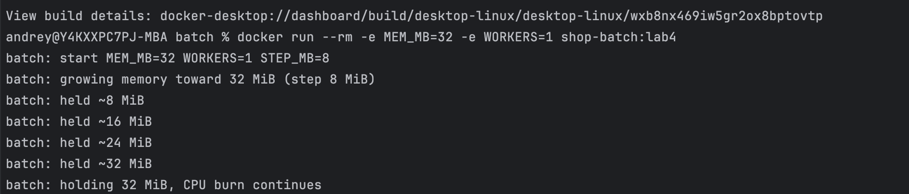

---

## Часть 1. Выбор механизма разнесения

В `values.yaml` добавил параметр `spreading.mechanism`: можно выбрать `topologySpreadConstraints` или `podAntiAffinity` (или `disabled`).

`podAntiAffinity` говорит «не сажай этот под рядом с такими же» по лейблам. Можно жёстко (`required`) или мягко (`preferred`). На кластере из 1-2 нод жёсткий вариант легко оставит лишние реплики в Pending: трём api физически некуда разъехаться по одной на ноду.

`topologySpreadConstraints` следит за равномерностью. `maxSkew` это насколько можно перекосить раскладку по `topologyKey`. Есть `ScheduleAnyway`: если идеально не получается, под всё равно встанет.

Выбрал `topologySpreadConstraints` с `topologyKey: kubernetes.io/hostname` и `whenUnsatisfiable: ScheduleAnyway`. На тесной площадке из 1-2 нод это даёт разнесение без риска вечного Pending. Переключение на anti-affinity остаётся одной строкой в values.

## Часть 2. Тесная площадка

Кластер kind на 2 ноды (control-plane + worker), специально тесный. Batch добавил шаблоном в чарт `shop`: requests/limits, labels, `readOnlyRootFilesystem`, образ как требуют гвардрейлы. Деплой через helm. Все поды Running.

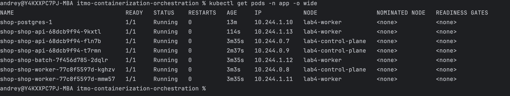

## Часть 3. Реальные числа вместо угадывания

Для пути заказа взял api с `/order` и Postgres. Нагрузил через k6: 2527 заказов, ошибок 0, p95 около 107 мс.

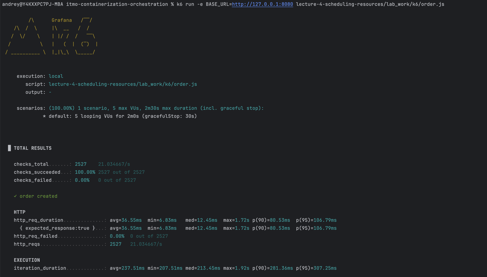

Дал Prometheus насобирать метрики, прогнал `krr` (история примерно час после нагрузки).

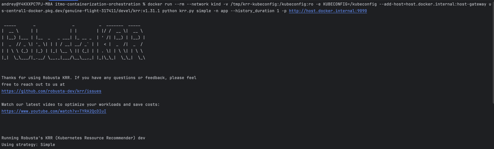

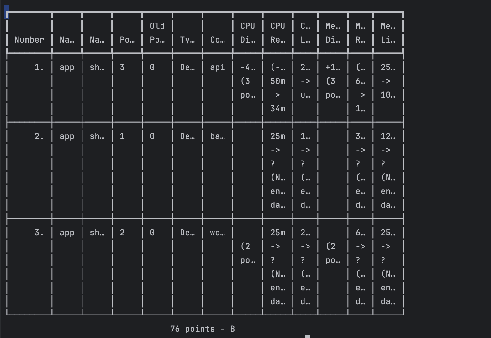

| сервис | было (догадка) | предложил krr | что поставил |
|---|---|---|---|
| api | cpu 50m/250m, mem 64Mi/256Mi | cpu req 34m, cpu lim unset, mem 100Mi/100Mi | cpu 34m/250m, mem 100Mi/100Mi |
| worker | cpu 25m/250m, mem 64Mi/256Mi | недостаточно данных (`?`) | оставил догадку |
| batch | cpu 25m/100m, mem 32Mi/128Mi | недостаточно данных (`?`) | оставил догадку |
| postgres | cpu 100m/500m, mem 256Mi/512Mi | krr по CNPG не отдал в том же скане | оставил догадку |

По api догадка была с запасом по CPU request (50m vs реальные ~34m) и с лишней памятью в limit (256Mi), а request памяти наоборот занизил (64Mi vs 100Mi). krr смотрит фактическое потребление под нагрузкой заказами, а не «на глаз». CPU limit он советует убрать (меньше throttling), но гвардрейлы лабы 3 требуют limits у всех контейнеров, поэтому потолок 250m оставил. У worker/batch точек метрик мало, почти без нагрузки, поэтому `?`.

Сырой отчёт: [`krr-app.json`](krr-app.json).

## Часть 4. Разнести критический сервис

На api включил `topologySpreadConstraints` из Части 1 (`topologyKey: kubernetes.io/hostname`, `maxSkew: 1`, `ScheduleAnyway`). Три реплики не сидят на одной ноде: часть на `lab4-control-plane`, часть на `lab4-worker`.

Если одна нода умрёт, заказы продолжат принимать реплики на второй. Без разнесения все три api могли бы оказаться на одном узле и упасть вместе.

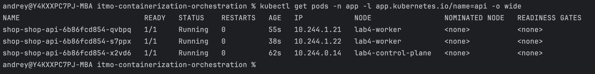

## Часть 5. Приоритеты и гарантии

Добавил `PriorityClass` (`shop-high` / `shop-low`) и `PodDisruptionBudget` для api и postgres.

api и postgres: QoS Guaranteed (`requests = limits` на числах из Части 3), `priorityClassName: shop-high`. PDB у api (`maxUnavailable: 1`); у postgres свой PDB от CNPG.

batch: QoS Burstable (`requests` заметно ниже `limits`), `shop-low`. Лимиты есть, просто слабее защищён.

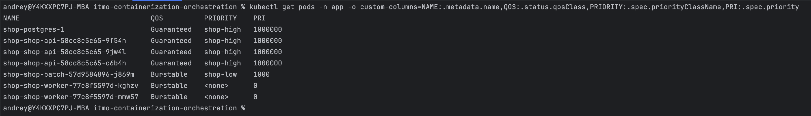

Под давлением high priority даёт preemption: api/postgres могут вытеснить batch, чтобы сесть на ноду. PDB не даёт снести сразу все реплики api при drain. Guaranteed выселяется последним при нехватке памяти на ноде, Burstable раньше, BestEffort первым.

## Часть 6. Нехватка и preemption

Поднял `batch.replicas` и requests у batch, пока кластер перестал всё вмещать.

Pending: `FailedScheduling` / `Insufficient memory`. Планировщик смотрит на сумму **requests**, не на реальное потребление. Batch с request 1500Mi не влезает.

Preemption: под с `shop-high` (как api) вытеснил batch с `shop-low`. В событии видно `Preempted by pod ... on node lab4-worker`.

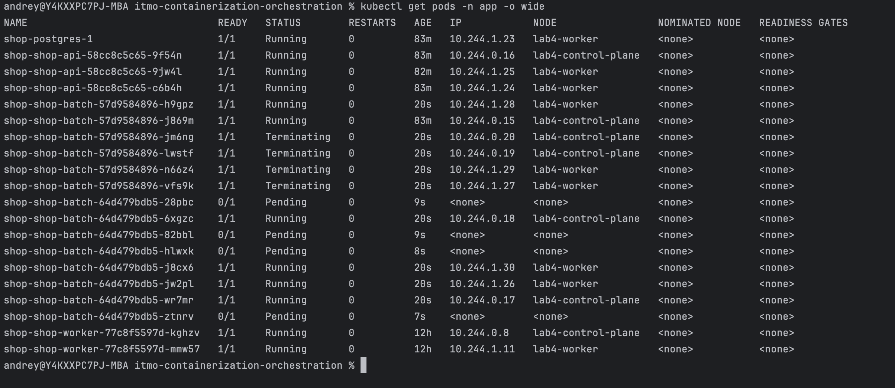

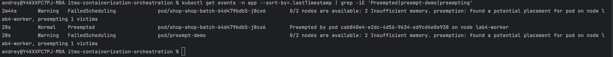

## Часть 7. Давление по памяти

Поднял реальное потребление batch (`MEM_MB`), requests оставил маленькими (Burstable). Под давлением памяти на ноде kubelet выселил batch: `Failed` / `Evicted`, в событии видно что consumption >> request. api и postgres (Guaranteed) остались Running.

Это не `OOMKilled`. OOMKilled значит контейнер превысил свой limit (cgroup). Evicted значит ноде плохо по памяти, kubelet жертвует поды по QoS и приоритету. Симптом похож, диагноз разный.

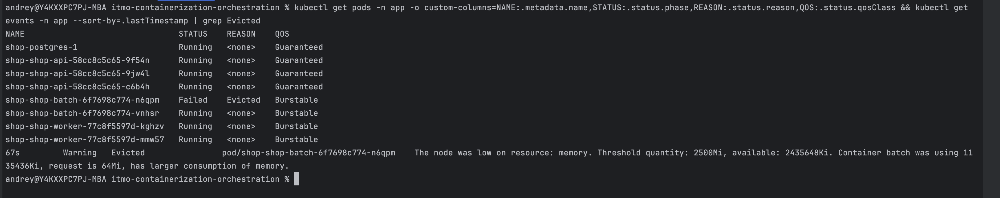

## Часть 8. SLA под нагрузкой

Сформулировал SLA на путь заказа: 95% заказов быстрее 1 с, ошибок меньше 1%. На тесном kind из 2 нод 300 мс стабильно не вытягивается (postgres + shared CPU), поэтому порог честный под площадку.

Гнал k6 по `/order` при живом batch (Burstable/low). Результат: checks ~99.7%, ошибок 0.29%, p95 ~983 мс. SLA зелёный. Критический путь держится, batch при жёсткой перегрузке жертвуется (Часть 7).

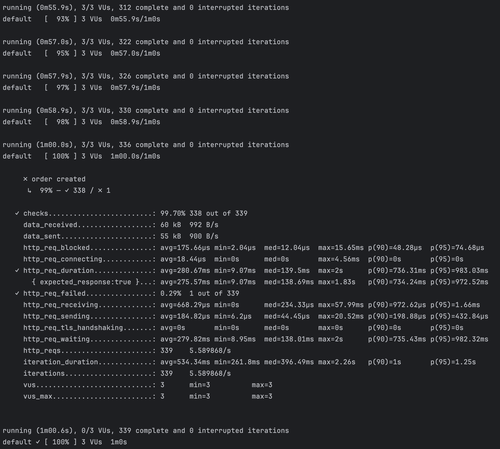

Скрипт: [`k6/sla.js`](k6/sla.js), лог: [`k6/sla-last-run.txt`](k6/sla-last-run.txt).

## Часть 9. Мониторинг

В чарт добавил `ServiceMonitor` и `PrometheusRule` (стек из лабы 2 / kube-prometheus-stack). Три алерта:

1. `ShopApiHighErrorRate`: доля 5xx больше 5%. Критический путь не должен сыпать ошибками, когда жертвуем batch.
2. `ShopApiHighP95Latency`: p95 больше 1 с. Прямо про SLA из Части 8.
3. `ShopApiTargetDown`: Prometheus не видит api. Без метрик SLA не доказать.

Спровоцировал срабатывание через `/fail`. Алерт `ShopApiHighErrorRate` ушёл в `firing`.

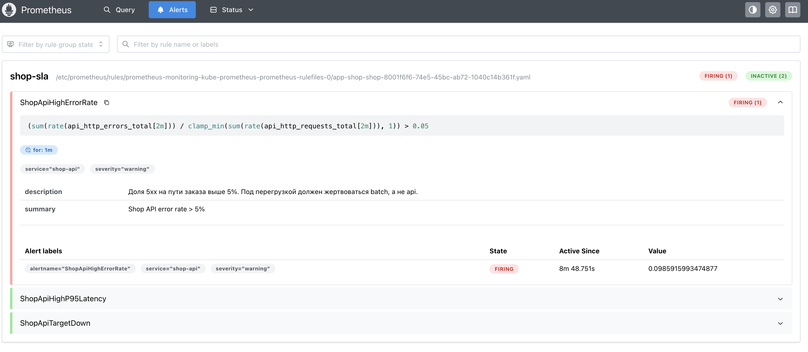
