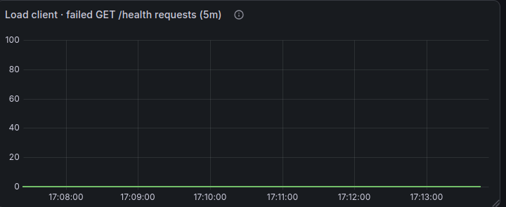
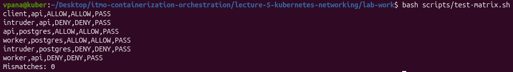
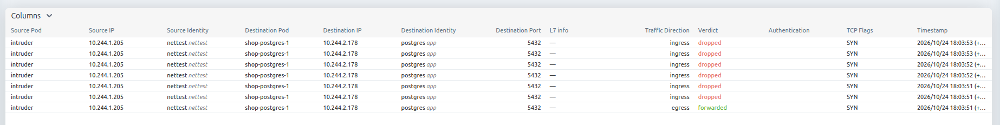
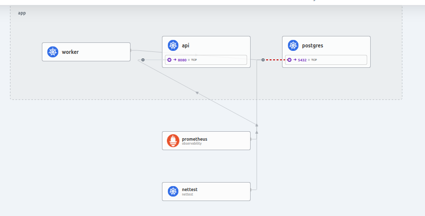
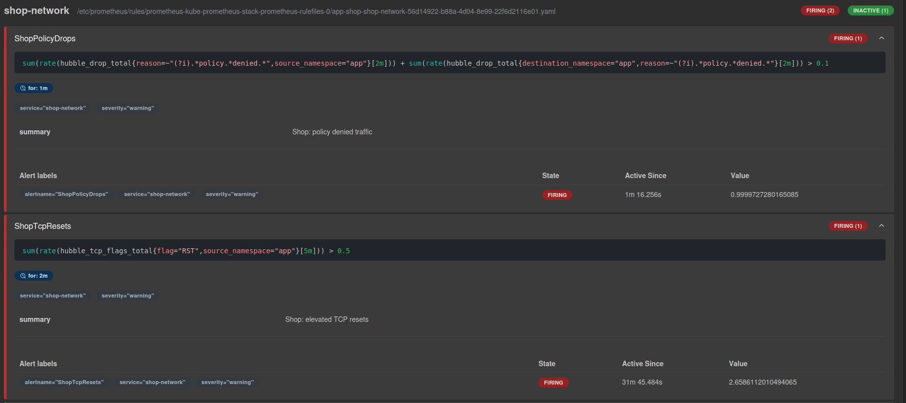

# Лабораторная работа №5 — Kubernetes Networking: Zero Trust

В этой лабораторной я разбирался с сетью Kubernetes на примере приложения `shop`. Проверил, как общаются Pod на разных нодах, что происходит с доступом к приложению при пересоздании Pod и как ограничить соединения через `NetworkPolicy`.

Кластер поднял в kind, вместо стандартного CNI использовал Cilium с Hubble. Само приложение развернул через Helm-чарт из [лабораторной №3](../lecture-3-kubernetes-control-plane/), а для сетевых метрик взял Prometheus и Grafana из [лабораторной №2](../lecture-2-observability/).

Конфигурации и скрипты лежат в [`lab-work`](./lab-work), скриншоты проверок — в [`screenshots`](./screenshots).

## Часть 0. Выбор CNI

Остановился на **Cilium**. Для лабораторной нужен CNI с поддержкой `NetworkPolicy`, а здесь ещё есть Hubble: через него можно посмотреть, какие соединения проходят, а какие блокируются. Cilium работает с eBPF, что тоже пригодится для наблюдения за сетевым трафиком.

В [`kind-config.yaml`](./lab-work/kind-config.yaml) отключил стандартный CNI (`disableDefaultCNI: true`) и задал три ноды: один control-plane и два worker.

```bash
kind create cluster --name lab5 --config lab-work/kind-config.yaml
helm upgrade --install cilium cilium/cilium --version 1.20.3 \
  -n kube-system -f lab-work/cilium-values.yaml --wait
```


Helm завершил установку со статусом `deployed`; в выводе есть Hubble Relay и Hubble UI. До установки CNI ноды показывались как `NotReady` — это ожидаемо, поскольку Pod-сеть ещё не работала. Саму связность проверил в следующей части.

## Часть 1. Исследование сети Pod

Создал два диагностических Pod с образом `netshoot`: `test-a` на `lab5-worker`, `test-b` на `lab5-worker2`. Посмотрел IP-адрес, интерфейс `eth0` и маршруты внутри `test-a`, затем проверил интерфейсы на ноде.

```bash
kubectl get pods -n nettest -o wide
kubectl exec -n nettest test-a -- ip addr show eth0
kubectl exec -n nettest test-a -- ip route
kubectl exec -n nettest test-a -- cat /sys/class/net/eth0/iflink
docker exec lab5-worker ip -o link show
```


В одном из запусков `test-a` получил адрес `10.244.2.103/32`, а его интерфейс отображался как `eth0@if13`. `test-b` находился на другой worker-ноде. На стороне ноды видны интерфейсы `lxc...` и `cilium_*`, связанные с сетью Cilium. По этим скриншотам нельзя однозначно сопоставить конкретную пару veth.

Дальше проверил, проходит ли трафик напрямую между Pod на разных нодах, без Service:

```bash
POD_B_IP=$(kubectl get pod test-b -n nettest -o jsonpath='{.status.podIP}')
kubectl exec -n nettest test-a -- ping -c 3 "$POD_B_IP"
```


Получил **3 ответа из 3, потерь нет**. Скриншот с `ping` сделан в другом запуске, поэтому IP получателя на нём отличается от предыдущего снимка. Проверка показывает, что Pod смогли обменяться пакетами.

## Часть 2. NodePort и хаос Pod

Развернул `shop` через Helm: три реплики `api`, две `worker` и PostgreSQL под управлением CloudNativePG. Для API настроил `NodePort`. Приложение слушает TCP `8080`, нода принимает запросы на `30080`, а kind пробрасывает локальный `127.0.0.1:18080` на этот порт.

`LoadBalancer` здесь потребовал бы отдельной интеграции с балансировщиком. Headless Service тоже не подходил для этой проверки: у него нет обычного виртуального ClusterIP, через который распределяются запросы между Pod.

```bash
helm lint lab-work/chart/shop
helm upgrade --install shop lab-work/chart/shop -n app --create-namespace --wait
kubectl exec -n nettest client -- \
  curl -fsS http://shop-shop-api.app.svc.cluster.local:8080/health
```


Запрос из Pod `client` вернул `ok` по адресу `shop-shop-api.app.svc.cluster.local`. Значит, внутри кластера DNS-имя разрешается и доступ через Service работает.

После этого проверял поведение приложения при удалении Pod. Скрипт [`chaos.sh`](./lab-work/scripts/chaos.sh) случайно удаляет `api` или `worker`, а Deployment создаёт замену. В это же время [`availability.sh`](./lab-work/scripts/availability.sh) отправляет запросы через Service и записывает HTTP-коды в CSV.

```bash
# Запускал в двух терминалах
bash lab-work/scripts/availability.sh 500 0.4
bash lab-work/scripts/chaos.sh 20

# Наблюдение за Pod
kubectl get pods -n app -o wide -w
```




На скриншотах видно, как Pod удаляются, а новые экземпляры получают другие IP. Результаты запросов вынесены на график.

## Часть 3. Целевая матрица доступа

Перед настройкой политик записал, кому и куда вообще нужно ходить. Клиенту нужен API, а `api` и `worker` обращаются к PostgreSQL. Остальные соединения из матрицы планировал закрыть.

Отдельно учёл служебный трафик: CoreDNS на TCP/UDP `53`, сбор `/metrics` Prometheus, порт `8000` у CloudNativePG и соединения PostgreSQL с Kubernetes API. Если забыть про эти исключения, можно случайно сломать работающие компоненты вместе с лишними доступами.

| Источник | Получатель | Порт | Ожидание |
|---|---|---|---|
| `nettest/client` | `api` | TCP 8080 | ALLOW |
| `api` | PostgreSQL | TCP 5432 | ALLOW |
| `worker` | PostgreSQL | TCP 5432 | ALLOW |
| `nettest/intruder` | `api` | TCP 8080 | DENY |
| `nettest/intruder` | PostgreSQL | TCP 5432 | DENY |
| `worker` | `api` | TCP 8080 | DENY |

## Часть 4. Включение Zero Trust

Политики добавил в [шаблоны Helm-чарта `shop`](./lab-work/chart/shop/templates/). Разрешённые порты и другие настройки вынес в `values.yaml`, чтобы менять их через Helm, а не редактировать уже созданные ресурсы вручную.

За основу взял `shop-default-deny`. Она выбирает все Pod в namespace `app` через `podSelector: {}` и запрещает входящий и исходящий трафик, если для него нет отдельного разрешения. Другими политиками открыл доступ клиенту к API, обращения `api` и `worker` к PostgreSQL, DNS и необходимый служебный трафик.

```bash
helm upgrade shop lab-work/chart/shop -n app \
  --set networkPolicy.enabled=true
kubectl get networkpolicy,ciliumnetworkpolicy -n app
kubectl describe networkpolicy shop-default-deny -n app
```


У `shop-default-deny` нет собственных разрешающих правил. После её включения Pod `api`, `worker` и PostgreSQL остались в состоянии `Running`, а CloudNativePG показывал `Cluster in healthy state`.

## Часть 5. Проверка матрицы на практике

Для проверки написал [`test-matrix.sh`](./lab-work/scripts/test-matrix.sh). Скрипт пробует соединиться с нужными адресами из разных Pod и сверяет результат с ожидаемым `ALLOW` или `DENY`.

```bash
bash lab-work/scripts/test-matrix.sh
```



Все шесть проверок прошли: `PASS`, итог — **`Mismatches: 0`**. `api` и `worker` смогли подключиться к PostgreSQL, а `intruder` не получил доступ ни к API, ни к базе. Проверка также подтвердила остальные правила из матрицы.

Затем открыл Hubble, чтобы увидеть блокировку на уровне сети, а не только ошибку команды `nc`.



На скриншоте Hubble видны TCP SYN от `intruder` в namespace `nettest` к `shop-postgres-1` в `app` на порт `5432`. У соединения стоит `verdict=dropped` — пакет действительно отброшен сетевой политикой.

## Часть 6. Внесение и разбор сетевой неисправности

Для этой части подготовил [`inject-fault.sh`](./lab-work/scripts/inject-fault.sh). Он выбирает один из четырёх вариантов поломки: закрывает `api` доступ к PostgreSQL, закрывает его для `worker`, подставляет неверный порт PostgreSQL или отключает DNS. Изменения применяются через `helm upgrade`.

**Отдельно разобрал сценарий с неверным портом PostgreSQL.** Вместо рабочего TCP `5432` указал в настройках политик `5433`:

```bash
helm upgrade shop lab-work/chart/shop -n app \
  -f lab-work/chart/shop/values.yaml \
  --set networkPolicy.enabled=true \
  --set networkPolicy.postgresPort=5433
```


В [`networkpolicy-api.yaml`](./lab-work/chart/shop/templates/networkpolicy-api.yaml), [`networkpolicy-worker.yaml`](./lab-work/chart/shop/templates/networkpolicy-worker.yaml) и [`networkpolicy-postgres.yaml`](./lab-work/chart/shop/templates/networkpolicy-postgres.yaml) порт берётся из `.Values.networkPolicy.postgresPort`. После замены на `5433` разрешения перестают совпадать с реальным портом PostgreSQL — `5432`. Поэтому соединение на `5432` должно блокироваться политиками, даже если имя `shop-postgres-rw` успешно разрешается через DNS.

В Hubble посмотрел карту соединений:



На ней есть красная пунктирная связь в направлении PostgreSQL.

Отдельно запускал автоматическую случайную поломку:

```bash
bash lab-work/scripts/inject-fault.sh
```


Скрипт вывел `One fault injected`, Helm применил ревизию 4.

Для возврата к исходным настройкам выполнил `helm upgrade` с базовым `values.yaml`. Такая же логика заложена в [`recover.sh`](./lab-work/scripts/recover.sh).

```bash
helm upgrade shop lab-work/chart/shop -n app \
  -f lab-work/chart/shop/values.yaml \
  --set networkPolicy.enabled=true
```


После восстановления повторил проверку матрицы доступа:


## Часть 7. Мониторинг и три сетевых алерта

Для мониторинга использовал уже развёрнутые Prometheus и Grafana из лабораторной №2. После установки Prometheus Operator включил `ServiceMonitor` для Cilium/Hubble. Среди доступных метрик — `hubble_flows_processed_total`, `hubble_drop_total`, `hubble_tcp_flags_total` и `hubble_dns_responses_total`.

В [`prometheusrule.yaml`](./lab-work/chart/shop/templates/prometheusrule.yaml) настроил три алерта:

- **`ShopPolicyDrops`** — более 0,1 блокировки NetworkPolicy в секунду за 2 минуты; `for: 1m`.
- **`ShopTcpResets`** — более 0,5 TCP RST в секунду за 5 минут; `for: 2m`.
- **`ShopDnsFailures`** — более 0,1 ошибки DNS в секунду за 5 минут; `for: 2m`.

Пороги выбрал для лабораторной, а не для продакшена. Например, TCP RST сам по себе ещё не означает неисправность. Правила входят в Helm-чарт `shop` как `PrometheusRule`, а JSON дашборда лежит в [`grafana-dashboard.json`](./lab-work/monitoring/grafana-dashboard.json).



На скриншоте в Prometheus одновременно сработали `ShopPolicyDrops` (около `1,0` при пороге `0,1`) и `ShopTcpResets` (около `2,66` при пороге `0,5`). Оба находятся в состоянии `FIRING`; `ShopDnsFailures` остался `INACTIVE`. Скриншота импортированного дашборда Grafana в репозитории нет.
